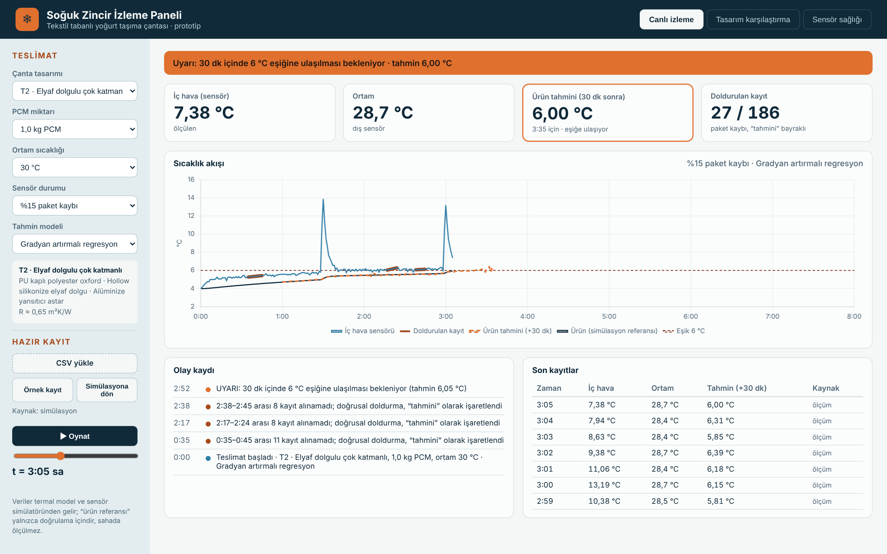
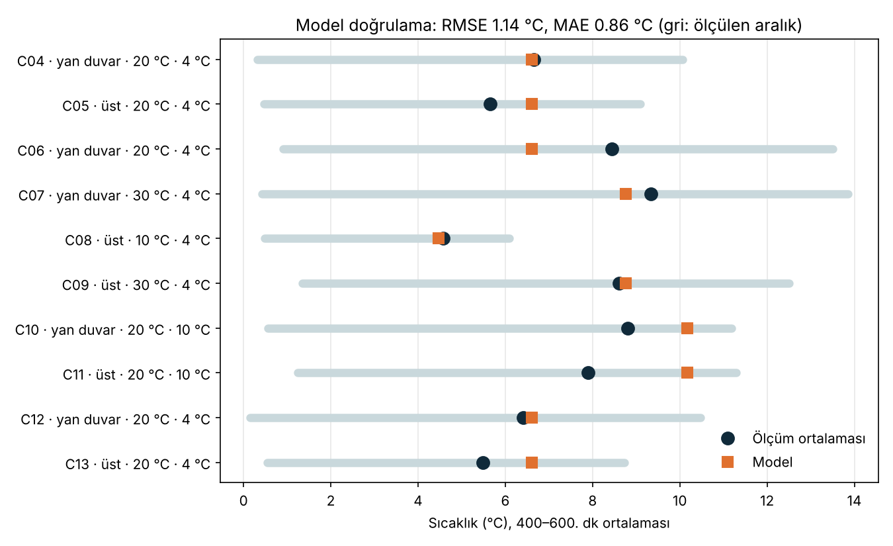
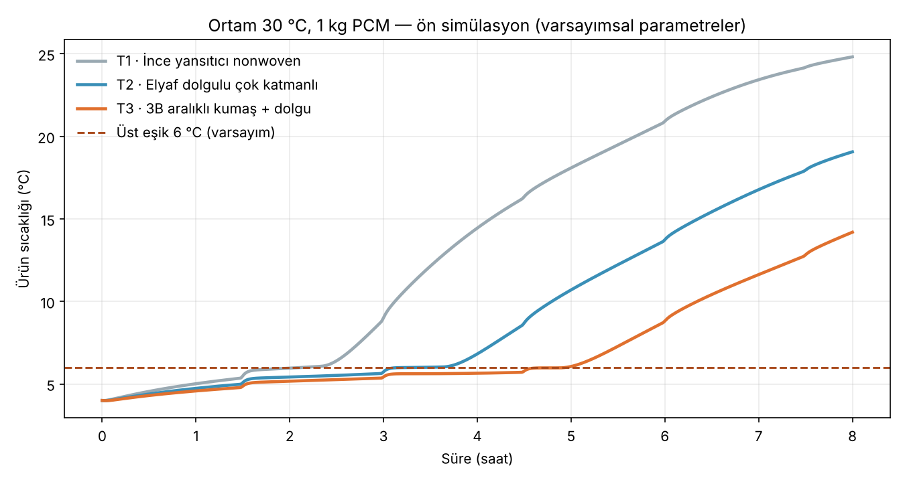
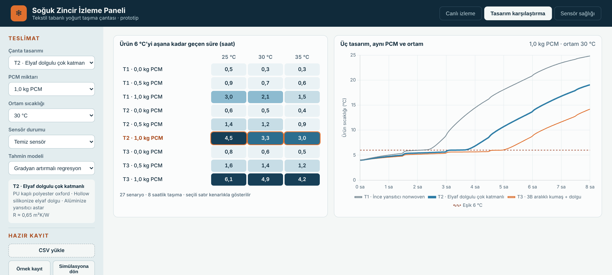
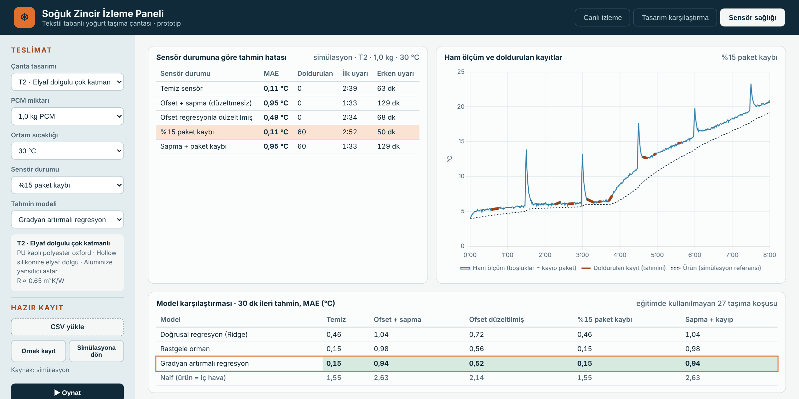

# Tekstil Tabanlı Soğuk Zincir Çantaları: Termal Simülasyon, Sıcaklık Tahmini ve Web İzleme

Yoğurt taşımacılığı için tasarlanan, faz değiştiren malzeme (PCM) içeren **üç tekstil çanta tasarımının** sıcaklık koruma performansını karşılaştıran, ürün sıcaklığını **30 dakika önceden tahmin eden** ve eşik aşılmadan **uyarı veren** simülasyon ve yazılım prototipi.

> Disiplinler arası mühendislik projesi · Tekstil, Gıda, Elektrik-Elektronik ve Bilgisayar Mühendisliği



## Ne yapıyor?

| Bileşen | Açıklama |
|---|---|
| **Termal model** | 3 düğümlü (iç hava, ürün, PCM) toplu parametreli ısı transferi modeli; PCM için entalpi yöntemi, PCM cepli astar, dağıtım duraklarında kapak açılması |
| **Senaryolar** | 3 tasarım × 3 PCM miktarı (0 / 0,5 / 1 kg) × 3 ortam sıcaklığı (25 / 30 / 35 °C) = **27 senaryo**, her biri 8 saat |
| **Deneysel doğrulama** | Model, PCM’li yalıtımlı kutu için yayımlanmış **açık deney verisiyle** karşılaştırılır (10 koşul) |
| **Sensör modeli** | DS18B20 benzeri sensör: gürültü, 0,0625 °C çözünürlük, ofset + sapma, patlamalı paket kaybı |
| **Veri iyileştirme** | Regresyonla kalibrasyon (ofset düzeltme), eksik verinin kestirimi ve **“tahmini” olarak işaretlenmesi** |
| **Tahmin** | 30 dk ileri ürün sıcaklığı; **3 model** karşılaştırılır: doğrusal regresyon, rastgele orman, gradyan artırma. Eğitim ve test koşuları birbirinden ayrıdır |
| **Web paneli** | FastAPI + Chart.js: canlı izleme, eşik uyarısı, olay kaydı, tasarım karşılaştırma, sensör sağlığı, model seçimi, **CSV ile kayıt yükleme** |

Fiziksel donanım kullanılmaz; sensör ve veri akışı yazılımda modellenir.

## Web uygulamasını çalıştırma

### Seçenek 1 · Tarayıcıda, kurulum olmadan (GitHub Codespaces)

[](https://codespaces.new/tugbasaridas/soguk-zincir-tekstil-canta)

Düğmeye basın ve **Create codespace** deyin. Ortam kurulurken bağımlılıklar yüklenir, ön çalışma çalıştırılır ve panel 8000 portunda kendiliğinden açılır (ilk kurulum birkaç dakika sürer). Panel açılmazsa alttaki **Ports** sekmesinde 8000’in yanındaki küre simgesine tıklayın.

### Seçenek 2 · İnternette yayına alma (Render, isteğe bağlı)

Depodaki `render.yaml` hazırdır: [render.com](https://render.com) → **New → Blueprint** → bu depoyu seçin. Herkesin açabileceği bir bağlantı verir. Ücretsiz planda servis bir süre kullanılmazsa uykuya geçer; ilk açılış yaklaşık 1 dakika sürebilir.

### Seçenek 3 · Kendi bilgisayarınızda

Python 3.10 veya üzeri gerekir.

```bash
git clone https://github.com/tugbasaridas/soguk-zincir-tekstil-canta.git
cd soguk-zincir-tekstil-canta

python -m venv .venv
# Windows: .venv\Scripts\activate    macOS/Linux: source .venv/bin/activate
pip install -r requirements.txt

# 1) Tüm ön çalışmayı çalıştır (~30 sn) -> cikti/ klasörü
python calistir_hepsi.py

# 2) Web panelini aç
python -m uvicorn panel.app:app --port 8000
# Tarayıcı: http://localhost:8000
```

Panel ilk açılışta, `cikti/` içinde eğitilmiş model yoksa varsayılan modeli (gradyan artırma) kendisi eğitir; diğer modeller panelde ilk seçildiklerinde eğitilir.

### Panel kısayolları

Ekran görüntüsü ya da sunumda doğrudan bir duruma gitmek için URL parametreleri:

```
http://localhost:8000/?tab=canli&tasarim=T2&pcm=1&ortam=30&bozulma=kayip&model=gbr&t=150
http://localhost:8000/?tab=karsilastirma&pcm=1&ortam=30
http://localhost:8000/?tab=sensor&tasarim=T2&pcm=1&ortam=30
http://localhost:8000/?tab=canli&kayit=ornek&t=170
```

| Parametre | Değerler |
|---|---|
| `tab` | `canli`, `karsilastirma`, `sensor` |
| `tasarim` | `T1`, `T2`, `T3` |
| `pcm` | `0`, `0.5`, `1` |
| `ortam` | `25`, `30`, `35` |
| `bozulma` | `temiz`, `sapma`, `duzeltilmis`, `kayip`, `hepsi` |
| `model` | `dogrusal`, `orman`, `gbr` |
| `t` | dakika (kaydırıcının konumu) |
| `kayit=ornek` | örnek CSV kaydını yükler |

## Klasör yapısı

```
├── termal_model.py        # Çanta tasarımları ve 3 düğümlü ısı transferi modeli
├── senaryolar.py          # 27 senaryonun simülasyonu, eşik süreleri
├── tahmin.py              # Sensör modeli, bozulmalar, 3 tahmin modeli, ayrık test
├── dogrulama.py           # Açık deney verisiyle model doğrulama
├── grafikler.py           # Rapor grafikleri (PNG)
├── calistir_hepsi.py      # Hepsini sırayla çalıştırır
├── ornek_kayit_uret.py    # CSV yükleme için örnek biçim dosyası üretir
├── ornek_kayit_formati.csv
├── panel/
│   ├── app.py             # FastAPI arka uç (REST API)
│   └── static/            # Arayüz: index.html, app.js, style.css, Chart.js
├── veri/                  # Doğrulama veri seti (CC BY 4.0, bkz. veri/README.md)
├── docs/img/              # README görselleri
├── .devcontainer/         # GitHub Codespaces ayarı (tek tıkla çalıştırma)
└── render.yaml            # Render.com'da yayına alma ayarı
```

## Çanta tasarımları

Hepsi 30 × 20 × 25 cm; iç astara 0 / 0,5 / 1 kg PCM cebi dikilir.

| Tasarım | Katmanlar (dıştan içe) | Toplam ısıl direnç |
|---|---|---|
| **T1** · İnce yansıtıcı nonwoven | Polyester (1 mm) + nonwoven keçe (5 mm) + alüminize yansıtıcı astar | ≈ 0,40 m²K/W |
| **T2** · Elyaf dolgulu çok katmanlı | PU kaplı polyester oxford (1 mm) + silikonize elyaf dolgu (15 mm) + alüminize astar | ≈ 0,65 m²K/W |
| **T3** · 3B aralıklı kumaş + dolgu | T2 + 3B aralıklı (spacer) kumaş (10 mm) | ≈ 0,87 m²K/W |

Kumaş, yoğurt ve PCM parametreleri literatür aralıklarından seçilmiş **varsayımlardır**; `termal_model.py` dosyasının başındaki sabitlerden değiştirilebilir.

## Ön çalışma sonuçları

**Model doğrulama:** 10 deney koşulunda, modele hiçbir ayar yapılmadan **MAE 0,86 °C, RMSE 1,14 °C**.



**30 °C ortam, 1 kg PCM:** Ürünün 6 °C’yi aşma süresi T1 2,1 sa · T2 3,3 sa · T3 4,9 sa. PCM’siz hiçbir tasarım 1 saatten fazla dayanmıyor.



**Tahmin modelleri:** en iyi model (gradyan artırma) temiz veride 30 dk ileri tahminde **0,15 °C** ortalama hata yapıyor. Ayrıntılar [Makine öğrenmesi](#makine-öğrenmesi) bölümünde.

| Tasarım karşılaştırma | Sensör sağlığı |
|---|---|
|  |  |

## Makine öğrenmesi

### Problem

Sahada ürünün (yoğurdun) iç sıcaklığı ölçülmez; yalnızca çanta içindeki **hava sensörü** ve dış **ortam sensörü** vardır. Amaç, bu ölçümlerden ürünün **30 dakika sonraki sıcaklığını** tahmin edip eşik (6 °C) aşılmadan uyarı vermektir. Bu bir **regresyon** problemidir: hem “sanal sensör” (ölçülmeyen ürün sıcaklığı) hem de ileriye dönük tahmin.

### Veri

| | Eğitim | Test |
|---|---|---|
| Kaynak | Termal modelden **180 rastgele taşıma koşusu** | **27 senaryo ızgarası** (3 tasarım × 3 PCM × 3 ortam) |
| Parametreler | Isıl geçirgenlik UA 0,35–1,05 W/K, PCM 0 ya da 0,2–1,2 kg, ortam 22–37 °C (sürekli, rastgele) | Sabit ızgara değerleri, farklı rastgele tohumlar |
| Örnek sayısı | 75 780 (dakikalık) | 11 367 (her sensör durumu için) |

Eğitim ve test **koşu bazında** ayrıdır: bir taşıma koşusunun hiçbir dakikası hem eğitimde hem testte yer almaz. Literatür, sentetik veride rastgele satır bölmenin başarıyı şişirdiğini gösterdiği için ([6] Loisel vd.) bu yol seçildi.

### Girdi özellikleri (her dakika için 9 özellik)

| Özellik | Açıklama |
|---|---|
| `T_hava(t)`, `T_hava(t−5)`, `T_hava(t−15)`, `T_hava(t−30)` | İç hava sensörünün şimdiki ve geçmiş değerleri (dakika) |
| `T_hava(t) − T_hava(t−15)` | Son 15 dakikadaki ısınma hızı |
| `T_ortam(t)` | Dış ortam sensörü |
| `t` | Taşımanın başından beri geçen süre (saat) |
| `UA` | Çanta tasarımının toplam ısıl geçirgenliği (W/K) |
| `PCM kütlesi` | kg |

**Hedef:** `T_ürün(t + 30 dk)`.

### Sensör bozulmaları ve ön işleme

| Durum | Nasıl üretiliyor? | Nasıl işleniyor? |
|---|---|---|
| Temiz | σ = 0,1 °C gürültü + 0,0625 °C çözünürlük (DS18B20, 12 bit) | — |
| Ofset + sapma | +0,5 °C ofset, saatte +0,15 °C kayma | Yola çıkmadan 10 dk referans sensörle **regresyon kalibrasyonu**; kestirilen ofset çıkarılır |
| Paket kaybı | %15, 3–15 dakikalık kesintiler halinde | **Doğrusal kestirim** ile doldurulur, `doldurulmus=True` bayrağıyla ayrı tutulur |
| Sapma + kayıp | İkisi birlikte | — |

Modeller **yalnızca temiz veriyle** eğitilir; bozulmalar sadece testte uygulanır. Böylece “model hiç görmediği sensör hatalarına ne kadar dayanıklı?” sorusu ölçülür.

### Modeller

| Model | scikit-learn | Ayarlar |
|---|---|---|
| Doğrusal regresyon | `make_pipeline(StandardScaler(), Ridge)` | `alpha=1.0` |
| Rastgele orman | `RandomForestRegressor` | `n_estimators=150, min_samples_leaf=5` |
| Gradyan artırma | `HistGradientBoostingRegressor` | `max_iter=300, learning_rate=0.08` |
| Naif (karşılaştırma) | — | “30 dk sonraki ürün sıcaklığı = şimdiki iç hava sıcaklığı” |

### Sonuçlar (eğitimde kullanılmayan 27 koşu)

MAE: ortalama mutlak hata · P95: hataların %95’inin altında kaldığı değer (°C)

| Model | Temiz MAE / P95 | Ofset + sapma | Ofset düzeltilmiş | %15 paket kaybı | Sapma + kayıp |
|---|---|---|---|---|---|
| Doğrusal regresyon | 0,46 / 1,19 | 1,04 / 2,18 | 0,72 / 1,73 | 0,46 / 1,19 | 1,04 / 2,19 |
| Rastgele orman | 0,15 / 0,44 | 0,98 / 1,67 | 0,56 / 1,21 | 0,15 / 0,44 | 0,98 / 1,68 |
| **Gradyan artırma** | **0,15 / 0,40** | **0,94 / 1,60** | **0,52 / 1,13** | **0,15 / 0,40** | **0,94 / 1,61** |
| Naif | 1,55 | 2,63 | 2,14 | 1,55 | 2,63 |

**Yorum**
- **Gradyan artırma** her durumda en iyi; panelde varsayılan model odur. Rastgele orman çok yakın ama dosyası çok daha büyük (~165 MB) ve eğitimi daha yavaş.
- **Doğrusal regresyon** temiz veride 3 kat fazla hata yapıyor: PCM eridikçe oluşan sıcaklık platosu ve PCM bitince başlayan hızlı yükseliş doğrusal değil.
- **Sensör sapması** üç modeli de bozuyor (0,15 → 0,94 °C). Sorun modelde değil veride; regresyon kalibrasyonu hatayı %44 azaltıyor, saatlik kayma ise kalıyor. Kalibrasyon bu yüzden elektrik-elektronik iş paketinin kritik adımı.
- **%15 paket kaybı** doğrusal kestirimle neredeyse etkisiz (artış < 0,01 °C).
- Panelde, ofsetli sensör uyarıyı çok erken veriyor (örnek senaryoda 1:33 yerine 2:39’da gelmesi gereken uyarı). Bu “erken uyarı” iyi görünse de **yanlış alarm** demektir.

**Sınır:** Modeller sentetik veriyle eğitilip sentetik veriyle test edilmiştir; gerçek ölçümlerde başarı daha düşük olabilir. Termal modelin kendisi açık deney verisiyle doğrulanmıştır (yukarıda), ancak tahmin modelleri henüz gerçek bir taşıma kaydıyla sınanmamıştır. Panelin **CSV yükleme** özelliği bunun için hazırdır.

### Yeniden üretme ve yeni model ekleme

```bash
python tahmin.py      # 3 modeli eğitir, 27 koşuda 5 sensör durumunda test eder
                      # -> cikti/tahmin_sonuclari.json, cikti/model_*.pkl
```

Yeni bir model eklemek için `tahmin.py` içindeki `MODELLER` sözlüğüne bir satır eklemek yeterlidir; panel ve karşılaştırma tablosu onu otomatik olarak gösterir:

```python
MODELLER = {
    ...
    "mlp": ("Yapay sinir ağı", lambda: make_pipeline(StandardScaler(), MLPRegressor(hidden_layer_sizes=(64, 32), max_iter=300))),
}
```

## Hazır kayıt (CSV) yükleme

Panelde **“CSV yükle”** ile bir sıcaklık kaydı yüklenip aynı tahmin ve uyarı akışından geçirilebilir. Ayırıcı `;` ya da `,`, ondalık `,` ya da `.` olabilir.

| Sütun | Açıklama |
|---|---|
| `zaman` | `2026-07-15 08:00` biçiminde tarih-saat ya da başlangıçtan itibaren dakika |
| `ic_hava` | Çanta içi hava sıcaklığı (°C). Boş hücre ya da eksik dakika = alınamayan ölçüm |
| `ortam` | Dış ortam sıcaklığı (°C) |
| `urun` (isteğe bağlı) | Doğrulama için ürün sıcaklığı |

`ornek_kayit_formati.csv` yalnızca **biçim örneğidir**; simülasyondan üretilmiştir, gerçek ölçüm değildir.

## API

| Uç nokta | Açıklama |
|---|---|
| `GET /api/secenekler` | Tasarımlar, PCM ve ortam değerleri, bozulma türleri, modeller |
| `GET /api/kosu` | Bir senaryonun dakikalık simülasyonu + sensör verisi + tahmin (`tasarim, pcm, ortam, bozulma, model`) |
| `POST /api/kayit` | CSV kaydı yükle; gövde: CSV metni (`tasarim, pcm, model`) |
| `GET /api/karsilastirma` | 27 senaryonun eşik süreleri ve eğrileri |
| `GET /api/sensor_karsilastirma` | Bir senaryoda bozulma türüne göre hata ve uyarı zamanı |
| `GET /api/model_karsilastirma` | 3 modelin 27 test koşusundaki sonuçları |

Etkileşimli API belgesi: `http://localhost:8000/docs`

## Sınırlar

- Bulgular **simülasyon koşullarıyla sınırlıdır**. Sentetik veriyle test edilen modeller gerçekte daha düşük başarı gösterebilir (Loisel vd., 2022).
- Doğrulama verisi sert yalıtımlı bir kutudan, 0 °C’de eriyen PCM’den ve Tylose test ürününden gelir. Doğrulanan şey modelin fiziğidir; tekstil katman değerleri hâlâ literatür varsayımıdır.
- Model tek noktalıdır: kutu içindeki sıcaklık dağılımını değil, ortalamayı tahmin eder.
- Kesin raf ömrü tayini ve standart uygunluk iddiası kapsam dışıdır.

## Kaynaklar

1. Rattanakaran vd., *Horticulturae*, 7(10), 392, 2021.
2. Huang ve Piontek, *Applied Sciences*, 7(12), 1288, 2017.
3. Aguiar, Gaspar ve da Silva, *Energies*, 16(13), 5191, 2023.
4. Mondal, *Applied Thermal Engineering*, 28(11–12), 1536–1550, 2008.
5. Leungtongkum, Laguerre ve Flick, *Software Impacts*, 17, 100538, 2023.
6. Loisel vd., *Journal of Food Engineering*, 335, 111156, 2022.
7. Koritsoglou vd., *Sensors*, 20(21), 6389, 2020.
8. Ayanoglu ve Uysal, *Sensors*, 23(9), 4303, 2023.
9. Ramírez-Faz vd., *Sensors*, 20(3), 846, 2020.
10. Zhi vd., *CyTA – Journal of Food*, 16(1), 42–49, 2018.
11. FAO, “Food loss and food waste,” Policy Support and Governance Gateway.
12. Leungtongkum vd., *Data in Brief*, 2024, doi:10.1016/j.dib.2023.109934 · veri: doi:10.17632/sz5dgkz7k8.1
13. Leungtongkum vd., *Data in Brief*, 2022, doi:10.1016/j.dib.2022.108696

## Ekip

| Ad | Bölüm |
|---|---|
| Sude Işık | Elektrik-Elektronik Mühendisliği |
| Erdem Özel | Elektrik-Elektronik Mühendisliği |
| Fahrettin Buğra Korkmaz | Elektrik-Elektronik Mühendisliği |
| Tuğba Sarıdaş | Bilgisayar Mühendisliği |
| Özen Güçlüses | Gıda Mühendisliği |
| İpek Toprak | Tekstil Mühendisliği |

## Lisanslar

- `veri/` klasöründeki veri seti **CC BY 4.0** lisanslıdır; atıf bilgisi `veri/README.md` dosyasındadır.
- `panel/static/vendor/chart.umd.js`: [Chart.js](https://www.chartjs.org/), MIT lisansı.
